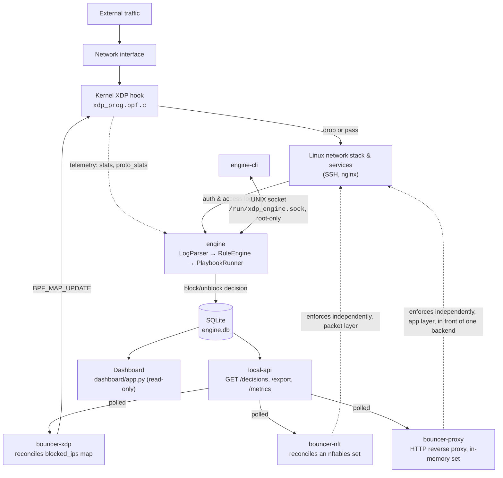

# Architecture

xdp-engine splits detection from enforcement (see
[ADR-0001](docs/adr/0001-architecture.md) and
[ADR-0002](docs/adr/0002-bouncer-xdp-separation.md)): `engine` decides what
to block and records that decision; `local-api` serves the current set of
decisions over HTTP; one or more independent **bouncer** processes poll
that feed and enforce it, each by its own mechanism. No component other
than a bouncer ever writes an enforcement map or rule — `engine` itself
only ever writes to `allowed_ips` (the safety-rail allowlist it checks
before proposing a block), never to `blocked_ips`.

## Data flow

`engine` writes to the `allowed_ips` BPF map directly (it's a safety rail,
not an enforcement decision) and reads `blocked_ips`/`stats`/`proto_stats`
read-only, purely to report whether a bouncer has caught up to a decision
yet (`[pending]` vs `[enforced]` in `list`/`stats`). It never writes
`blocked_ips` itself.

## Components

1. **Kernel space — `xdp_prog.bpf.c`.** Attached by `bouncer-xdp` (not by
   `engine`), it classifies and optionally drops packets at the network
   driver, before the kernel's normal networking stack sees them. State is
   exchanged with user space entirely through pinned BPF maps under
   `/sys/fs/bpf/xdp_engine/`.
2. **`engine` (C++20).** Tails application logs, parses them via the
   staged parser pipeline (`docs/detection.md`), evaluates `rules.yaml`
   (sequence/threshold rules, multi-stage correlation), and on a match
   runs the matching `playbooks.yaml` response — which records a
   block/unblock decision in `engine.db` rather than touching any
   enforcement map or rule directly. It also accepts commands (`block`,
   `unblock`, `list`, `stats`, ...) from `engine-cli` over a root-only
   UNIX socket (`/run/xdp_engine.sock`, `SO_PEERCRED`-checked).
3. **`local-api`.** Reads `engine.db` and exposes it over HTTP:
   `GET /decisions` for bouncers, `GET /export` for evidence/forensics,
   `GET /metrics` in Prometheus format. See [docs/local-api.md](docs/local-api.md).
4. **Bouncers.** Independent processes, each polling `/decisions` and
   enforcing it by a different mechanism — `bouncer-xdp` (BPF map,
   line-rate), `bouncer-nft` (nftables set, no XDP needed), `bouncer-proxy`
   (HTTP reverse proxy, application layer, no kernel privilege needed).
   See [docs/enforcement.md](docs/enforcement.md) for the full comparison
   and the privilege model each one uses.
5. **Dashboard (Python/Flask).** A read-only presentation layer: it polls
   the same SQLite database `engine` writes to and renders system health,
   live events, metrics, and active blocks. It cannot alter state.
