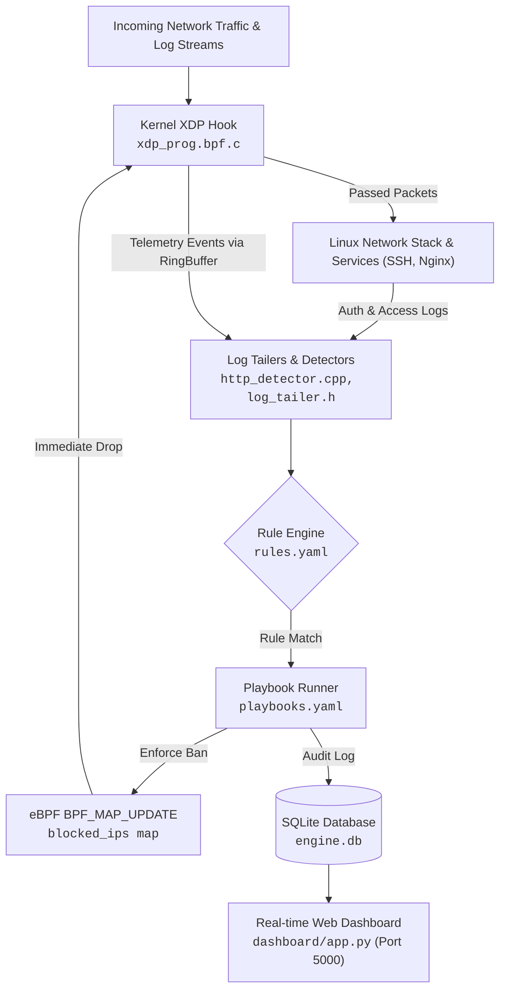

# 🛡️ XDP-Engine: Kernel-Speed Intrusion Mitigation & SOAR

An enterprise-grade, eBPF-powered firewall and Security Orchestration, Automation, and Response (SOAR) engine.  
Filters millions of malicious packets per second in Linux kernel space at driver speed before they reach the OS networking stack, backed by automated log correlation, rule-based playbooks, and a live web telemetry dashboard.


---

## 📌 Table of Contents
1. [Overview & Key Features](#-overview--key-features)
2. [System Architecture](#-system-architecture)
3. [Prerequisites & Dependencies](#-prerequisites--dependencies)
4. [Step-by-Step Setup Guide](#-step-by-step-setup-guide)
   - [Step 1: Clone the Repository](#step-1-clone-the-repository)
   - [Step 2: Build the Engine](#step-2-build-the-engine)
   - [Step 3: Launch the Web Dashboard](#step-3-launch-the-web-dashboard)
   - [Step 4: Launch Enforcement, the Local API, and the Engine](#step-4-launch-enforcement-the-local-api-and-the-engine-in-that-order)
5. [Interactive Console Commands](#-interactive-console-commands)
6. [Local API (decisions + export)](#-local-api-decisions--export)
7. [bouncer-xdp (enforcement)](#️-bouncer-xdp-enforcement)
8. [Detection Parsers (staged pipeline)](#-detection-parsers-staged-pipeline)
9. [replay-cli (log replay / backtesting)](#-replay-cli-log-replay--backtesting)
10. [Live Showcase Dashboard](#-live-showcase-dashboard)
11. [Testing & Attack Simulation Lab](#-testing--attack-simulation-lab)
    - [Test 1: Web Exploits (SQLi & Path Traversal)](#1-web-exploits-sql-injection--path-traversal)
    - [Test 2: SSH Brute-Force Protection](#2-ssh-brute-force-protection)
    - [Test 3: Network Port Scanning](#3-network-port-scanning)
    - [Test 4: Multi-Stage Attack Correlation ("Killshot")](#4-multi-stage-attack-correlation-the-killshot)
    - [Test 5: Volumetric SYN Flood (DDoS Mitigation)](#5-volumetric-syn-flood-ddos-mitigation)
12. [Configuration Files](#-configuration-files)
13. [Troubleshooting & FAQ](#-troubleshooting--faq)

---

## 🚀 Overview & Key Features

* **Kernel eBPF / XDP Filtering:** Drops packets at line rate (up to 2,000,000+ packets/sec) directly in the network driver before Linux allocates `sk_buff` socket buffers.
* **Massive Concurrency:** Hardware-backed BPF Hash Maps preallocate tracking for up to **1,000,000 unique IP addresses**.
* **Log Ingestion & Detection (SIEM):** Real-time asynchronous tailing of SSH authentication logs (`/var/log/secure` or `/var/log/auth.log`) and Web Server access logs (`/var/log/nginx/access.log`).
* **Automated Playbook Response (SOAR):** Declarative YAML playbooks automatically execute time-limited kernel bans, alert webhooks, and IP reputation tracking.
* **Complex Attack Correlation:** State machine tracks correlated multi-stage threats (e.g., `SCAN_THEN_BRUTE` sequences).
* **Dynamic Mode Switching:** Seamlessly toggle between **Detect Mode** (audit logging) and **Enforce Mode** (active kernel dropping) on the fly without restarting the engine.
* **Safety Guardrails:** Automatic whitelisting of `127.0.0.1`, local interface IPs, and default gateway routes to prevent accidental self-lockouts.

---

## 🏛️ System Architecture



---

## 📦 Prerequisites & Dependencies

### Minimum System Requirements
* **OS:** Linux with Kernel **5.8+** (with BTF enabled at `/sys/kernel/btf/vmlinux`).
* **Privileges:** Root access (`sudo`) for attaching XDP to network interfaces.

### Package Installation

#### Fedora / RHEL
```bash
sudo dnf install -y clang llvm libbpf-devel elfutils-libelf-devel \
    sqlite-devel yaml-cpp-devel libcurl-devel gtest-devel python3-flask make gcc-c++
```

#### Ubuntu / Debian
```bash
sudo apt update
sudo apt install -y clang llvm libbpf-dev libelf-dev libsqlite3-dev \
    libyaml-cpp-dev libcurl4-openssl-dev libgtest-dev python3-flask make g++
```

---

## 📖 Step-by-Step Setup Guide

Follow these 4 simple steps to get the entire engine and live dashboard running:

### Step 1: Clone the Repository
```bash
git clone https://github.com/v1shad/xdp-engine.git
cd xdp-engine
```

### Step 2: Build the Engine
Compile the eBPF kernel bytecode and the C++ user-space daemon:
```bash
make
```
*This generates `xdp_prog.bpf.o` (eBPF object) and `./engine` (C++20 binary).*

### Step 3: Launch the Web Dashboard
Open your **first terminal window** and run:
```bash
cd dashboard
python3 app.py
```
Open your browser to:
👉 **`http://127.0.0.1:5000/?showcase=1`**

*(While the engine is not yet started, the top-right badge cleanly pulses **`Loading Mode...`** in Standby).*

### Step 4: Launch Enforcement, the Local API, and the Engine (in that order)

Since [ADR-0002](docs/adr/0002-bouncer-xdp-separation.md), detection and
enforcement are separate binaries, and **startup order matters**:
`bouncer-xdp` must be running on an interface before `engine` will start
on it, because `engine` opens maps that only exist once `bouncer-xdp` has
pinned them.

1. Identify your active network interface (e.g. `wlp8s0` for Wi-Fi or `eth0` / `enp3s0` for Ethernet):
   ```bash
   ip route get 1.1.1.1 | awk '{print $5; exit}'
   ```
2. **Terminal 2 — enforcement** (replace `wlp8s0` with your interface name):
   ```bash
   sudo ./bouncer-xdp wlp8s0
   ```
   This loads `xdp_prog.bpf.c`, attaches it, and pins every map under
   `/sys/fs/bpf/xdp_engine/`. Leave it running — see the
   [bouncer-xdp](#-bouncer-xdp-enforcement) section below for what it's
   actually doing and how to clean it up.
3. **Terminal 3 — Local API** (so bouncer-xdp has decisions to poll):
   ```bash
   LOCAL_API_TOKEN=your-secret ./local-api engine.db 8088
   ```
4. **Terminal 4 — the engine itself**:
   ```bash
   sudo ./engine wlp8s0
   ```
   *To start directly in active hardware drop mode, add `--enforce`:*
   ```bash
   sudo ./engine wlp8s0 --enforce
   ```
   If this fails with "could not open pinned maps", `bouncer-xdp` isn't
   running on this interface yet — go back to step 2.

Within 1 second, the dashboard badge will light up in **`DETECT MODE`** (Blue) or **`ENFORCE MODE`** (Red)!

A block decided by the rule engine or by `block <IP>` below now takes
effect once `bouncer-xdp` applies it on its next poll (default every 2s),
not instantly — `list` shows `[pending]` vs `[enforced]` so you can see
exactly where a given IP is in that pipeline.

---

## 🎮 Interactive Console Commands

While `./engine` is running, you can type commands directly into its terminal:

| Command | Action | Example |
|---|---|---|
| `mode enforce` *(or `enforce`)* | Instantly switches the firewall to **Active Kernel Blocking** (Dashboard turns **RED**). | `mode enforce` |
| `mode detect` *(or `detect`)* | Switches to **Passive Detection Mode** without dropping packets (Dashboard turns **BLUE**). | `mode detect` |
| `mode show` *(or `mode`)* | Prints the current operating mode. | `mode` |
| `block <IP> [TTL]` | Records a block decision with optional expiry (default: 600s). `bouncer-xdp` applies it to the kernel on its next poll — see Step 4. | `block 192.168.1.100 300` |
| `unblock <IP>` | Records an unblock decision; `bouncer-xdp` removes the kernel entry on its next poll. | `unblock 192.168.1.100` |
| `allow <IP>` | Whitelists an IP so it will never be banned. | `allow 192.168.1.50` |
| `unallow <IP>` | Removes an IP from the whitelist. | `unallow 192.168.1.50` |
| `list` | Displays every active block decision, its remaining TTL, and whether `bouncer-xdp` has enforced it yet (`[enforced]`/`[pending]`). | `list` |
| `stats` | Prints real-time packet counters: dropped, passed, TCP, UDP, and ICMP. | `stats` |
| `alerts` | Prints the 10 most recent security alerts. | `alerts` |
| `quit` | Marks status `OFFLINE` and exits. Enforcement is unaffected — `bouncer-xdp` keeps running and keeps applying decisions independently. | `quit` |

---

## 🧭 Local API (decisions + export)

A separate `local-api` binary reads the same `engine.db` SQLite file the
engine writes to, and exposes it over HTTP. This is the first piece of the
architecture described in [`ROADMAP.md`](ROADMAP.md) — see
[`docs/adr/0001-architecture.md`](docs/adr/0001-architecture.md) for why.

```bash
make local-api
LOCAL_API_TOKEN=your-secret ./local-api engine.db 8088
```

| Endpoint | Purpose |
|---|---|
| `GET /healthz` | Liveness check, no auth required |
| `GET /decisions` | Active block decisions, as served to bouncers |
| `GET /export?type=alerts\|events&format=csv\|json&since=&until=` | Evidence export, filterable by ISO-8601 timestamp range |

Every request other than `/healthz` requires `Authorization: Bearer <token>`
matching `LOCAL_API_TOKEN`. If that variable is unset, the API logs a
warning and runs unauthenticated — fine for local testing, not for anything
reachable beyond localhost.

```bash
curl -H "Authorization: Bearer your-secret" \
  "http://127.0.0.1:8088/export?type=alerts&format=csv" -o alerts.csv
```

---

## 🛡️ bouncer-xdp (enforcement)

`bouncer-xdp` is the only binary that ever loads `xdp_prog.bpf.c` and
attaches it to a NIC (see [ADR-0002](docs/adr/0002-bouncer-xdp-separation.md)).
It has no rule engine and no database of its own — it just polls Local
API's `GET /decisions` and reconciles the kernel's `blocked_ips` map to
match, exactly like a CrowdSec remediation component.

```bash
sudo ./bouncer-xdp wlp8s0
# or, with non-default Local API settings:
sudo ./bouncer-xdp wlp8s0 --lapi-url http://127.0.0.1:8088 --lapi-token your-secret --poll-interval 2
```

On first attach it pins every map plus the XDP link itself under
`/sys/fs/bpf/xdp_engine/`. That means **restarting `bouncer-xdp` does not
drop enforcement** — on startup it notices the existing pins and just
resumes polling against the already-attached program instead of
re-attaching. To actually detach and remove the pins:

```bash
sudo ./bouncer-xdp cleanup wlp8s0
```

`LOCAL_API_TOKEN` is read from the environment the same way `local-api`
reads it; `--lapi-token` overrides it.

---

## 🧩 Detection Parsers (staged pipeline)

The regex that recognizes a raw log line and extracts named fields from
it (an IP, a username, a request path, a user-agent) lives in versioned
YAML under `parsers/s01-parse/`, not hardcoded in C++ — see
[ADR-0003](docs/adr/0003-staged-parser-pipeline.md). `SshDetector` and
`HttpDetector` each load one of these at startup via the `LogParser`
class (`log_parser.h`):

* **`parsers/s01-parse/ssh-auth.yaml`** — matches `Failed password for ...`
  lines from `/var/log/secure`/`/var/log/auth.log`, extracting `user` and
  `ip`.
* **`parsers/s01-parse/nginx-access.yaml`** — matches nginx's combined log
  format, extracting `ip`, `path` (URL-decoded), and `user_agent`.

A parser file looks like this:

```yaml
name: ssh-auth-failed-password
source: ssh_log
pattern: 'Failed password for (?:invalid user )?(\S+) from (\d{1,3}(?:\.\d{1,3}){3}) port \d+ ssh2'
fields:
  - name: user
    group: 1          # 1-based regex capture group
  - name: ip
    group: 2
emit_type: ssh_failed  # fixed event type for this source; omit if
                       # classification depends on the extracted fields
                       # (see nginx-access.yaml, classified against
                       # rules.yaml's http_traversal/http_sqli/
                       # http_scanner pattern lists instead)
severity: 3
```

This only replaces *envelope* parsing. The attack-signature pattern lists
that classify an HTTP request as traversal/SQLi/scanner already live in
`rules.yaml` and are untouched by this — see the ADR for why those
weren't also duplicated into parser YAML.

---

## ▶️ replay-cli (log replay / backtesting)

`tools/replay-cli` is a standalone CLI (ROADMAP.md Phase 2) that answers
"would this rule have fired against this log?" without touching a kernel,
root, or the live engine at all. It feeds a captured log file through the
same `LogParser` + `HttpClassifier` + `RuleEngine` code paths the live
`engine` process uses, and prints what would have alerted:

```bash
./tools/replay-cli --rules rules.yaml \
    --parser parsers/s01-parse/ssh-auth.yaml \
    --log /var/log/auth.log
```

```
Replayed 1 file(s) through 'parsers/s01-parse/ssh-auth.yaml' + 'rules.yaml'
  lines read:       5
  lines matched:    5
  alerts fired:     1
    - SSH_BRUTE_FORCE  src_ip=203.0.113.9  severity=high
```

* `--log` may be repeated to replay several files (e.g. rotated logs) as
  one combined run.
* `--format json` prints a machine-readable summary instead (counts plus
  one object per fired alert) for piping into other tooling.
* Pass an HTTP-style parser (`parsers/s01-parse/nginx-access.yaml`) to
  replay web-attack logs instead — the tool classifies traversal/SQLi/
  scanner the same way `HttpDetector` does, against the same `rules.yaml`
  pattern lists.

**Known limitation:** replayed events are timestamped with the replay's
own wall-clock time, not any timestamp recorded in the original log
line. For a single burst of lines (the common "did this attack log trip
my rule" use case) that's immaterial — threshold/sequence windows still
see the lines arrive in a tight cluster. It does mean a log file whose
entries were originally spread across hours replays as if they all
happened in whatever time it takes the tool to read the file. Faithfully
replaying original log timing would mean changing `RuleEngine`'s
window/threshold logic to run off parsed log timestamps instead of
`steady_clock`, which the live engine also depends on — judged out of
scope for this phase, the same honest-scope call the ADRs make elsewhere
about what else is and isn't built. See the comment at the top of
`replay_core.h` for the full reasoning.

---

## 🖥️ Live Showcase Dashboard

Navigate to **`http://127.0.0.1:5000/?showcase=1`** for the presentation/exhibition UI:

* **Top-Right Mode Badge:**
  * 🔴 **ENFORCE MODE:** Active hardware packet drops enforced at the driver level.
  * 🔵 **DETECT MODE:** Real-time log & signature auditing without dropping packets.
  * ⚪ **Loading Mode...:** Engine offline or awaiting connection (updates automatically via AJAX without page reloads).
* **Total Packets Dropped:** Real-time cumulative hardware drop counter.
* **Drop Rate Meter:** Instantaneous packets-per-second drop velocity.
* **Active Blocks / Attack Cards:** Displays currently blocked IPs with live countdown timers.
* **Live Engine Feed:** Color-coded audit trail of incoming detections, playbooks, and mitigation events.

---

## 🧪 Testing & Attack Simulation Lab

Use these safe test commands from another machine (or WSL / VM / local terminal) to simulate attacks and verify engine responses.  
*(Replace `<SERVER_IP>` with the IP of your machine running the engine).*

### 1. Web Exploits (SQL Injection & Path Traversal)
Sends malicious HTTP queries detected by the Nginx access log parser:
```bash
# SQL Injection attempt:
curl -m 5 "http://<SERVER_IP>/?id=1%27%20OR%201=1--"

# Directory Traversal attempt:
curl -m 5 --path-as-is "http://<SERVER_IP>/../../../../etc/passwd"
```

### 2. SSH Brute-Force Protection
Triggers the stateful sliding-window rule (5 failed attempts within 60 seconds):
```bash
# Automated brute-force simulation using Hydra:
hydra -l testuser -p wrongpass <SERVER_IP> ssh

# Or manually attempt 5 failed logins:
ssh wronguser@<SERVER_IP>
```

### 3. Network Port Scanning
Scans ports to trigger kernel-level port sweep detection:
```bash
# Fast SYN scan across ports 1-30:
nmap -Pn -sS -p 1-30 <SERVER_IP>
```

### 4. Multi-Stage Attack Correlation (The "Killshot")
Tests the `SCAN_THEN_BRUTE` sequence correlation engine:
1. First, execute a port scan: `nmap -Pn -sS -p 1-25 <SERVER_IP>`
2. Within 5 minutes, attempt an SSH login failure: `ssh fakeuser@<SERVER_IP>`
3. The engine correlates both signals into an escalated high-severity ban.

### 5. Volumetric SYN Flood (DDoS Mitigation)
Demonstrates line-rate kernel packet dropping:
```bash
# High-speed TCP SYN flood:
sudo hping3 -S -p 80 --flood <SERVER_IP>

# Multi-process parallel flood (higher PPS across multiple CPU cores):
for i in {1..8}; do sudo hping3 -S -p 80 --flood <SERVER_IP> & done

# Random IP spoofed botnet flood (tests 1,000,000 IP hash map capacity):
sudo hping3 -S -p 80 --flood --rand-source <SERVER_IP>
```

### 6. High-Speed 1-2 Million Drops/Sec Benchmark
*(Note: Physical Wi-Fi radio channels are physically capped around 30k–80k frames/sec due to 802.11 airtime and ACK overhead. To demonstrate XDP's full **1,000,000 to 2,000,000+ packets/sec** capability, use the in-memory virtual lab):*

1. **Start the Virtual Lab Interface:**
   ```bash
   ./tools/setup_veth_lab.sh start
   ```
2. **Start enforcement, Local API, and the engine on the virtual interface**
   (three terminals, in this order — see [Step 4](#step-4-launch-enforcement-the-local-api-and-the-engine-in-that-order)):
   ```bash
   sudo ./bouncer-xdp veth-bench
   LOCAL_API_TOKEN=your-secret ./local-api engine.db 8088
   sudo ./engine veth-bench --enforce
   ```
   *Type `block 198.51.100.2` in the engine console, then `list` — wait*
   *for it to show `[enforced]` (bouncer-xdp's next poll, ≤2s) before*
   *starting the flood below, or the first couple seconds of packets will*
   *pass through before enforcement catches up.*
3. **Launch the Multi-Thread Batch Generator (another terminal):**
   ```bash
   sudo ./tools/bench_flood 198.51.100.1 198.51.100.2 4 veth-gen 80
   ```
   *Watch the live showcase dashboard at `http://127.0.0.1:5000/?showcase=1` instantly display **1.5M - 2.0M+ drops/sec**!*
4. **Clean up when finished:**
   ```bash
   sudo ./bouncer-xdp cleanup veth-bench
   ./tools/setup_veth_lab.sh stop
   ```

---

## ⚙️ Configuration Files

* **`rules.yaml`:** Defines detection rules, regex signatures, sliding-window thresholds, and severity ratings.
* **`playbooks.yaml`:** Configures response actions per rule (e.g. kernel block duration, Slack/webhook notifications, escalation paths).
* **`known_ips.txt`:** Permanent administrative IP whitelist.
* **`blocklist.txt`:** Static permanent IP blacklist loaded on boot.
* **`parsers/s01-parse/*.yaml`:** Per-log-source envelope parsers (regex + field extraction) — see [Detection Parsers](#-detection-parsers-staged-pipeline).

---

## ❓ Troubleshooting & FAQ

**Q: The dashboard top-right badge stays on "Loading Mode..."?**  
* Ensure the engine is running (`sudo ./engine <INTERFACE>`). When the engine starts, it updates the status in `engine.db` within 1 second.
* Ensure both the engine and dashboard are run from the project root (`~/xdp-engine`).

**Q: "open failed: Permission denied"?**  
* eBPF operations require root privileges. Always execute `./bouncer-xdp` and `./engine` using `sudo`.

**Q: `engine` won't start — "could not open pinned maps under /sys/fs/bpf/xdp_engine"?**  
* `bouncer-xdp` isn't running on that interface yet (see [Step 4](#step-4-launch-enforcement-the-local-api-and-the-engine-in-that-order)) — `engine` no longer attaches XDP itself since [ADR-0002](docs/adr/0002-bouncer-xdp-separation.md), it just opens the maps `bouncer-xdp` pinned. Start `bouncer-xdp <INTERFACE>` first.

**Q: How do I cleanly detach XDP if `bouncer-xdp` crashed?**  
* A crash alone doesn't detach anything — that's the point of pinning (enforcement survives it). Run `sudo ./bouncer-xdp cleanup <INTERFACE>` to actually detach and remove the pins. If that binary is unavailable for some reason, the raw escape hatch is `sudo ip link set dev <INTERFACE> xdp off` plus `sudo rm -rf /sys/fs/bpf/xdp_engine`.

---

## 📄 License
This project is open-source under the [MIT License](LICENSE), with one
exception: `xdp_prog.bpf.c` is licensed under [GPL-2.0](LICENSE-GPL-2.0)
instead, because it uses Linux kernel eBPF helpers that the kernel's BPF
verifier only allows GPL-licensed programs to call. Each source file's own
`SPDX-License-Identifier` header is the authoritative marker for which
license applies to it.
