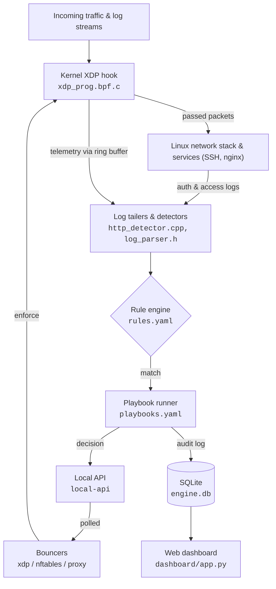

# xdp-engine

An eBPF/XDP-based intrusion mitigation engine for Linux, built around a
CrowdSec-style split between detection and enforcement: a rule engine
correlates log and traffic signals into decisions, and independent
"bouncer" processes enforce those decisions at whichever layer suits the
host — kernel driver, netfilter, or an HTTP reverse proxy.

The core firewall path (`xdp_prog.bpf.c`) attaches at the network driver
and can drop traffic at line rate, before it reaches the kernel's normal
networking stack. Detection (SSH brute force, SQL injection, path
traversal, port scans, correlated multi-stage attacks) runs in user space
against log tails and kernel telemetry, with responses driven by
declarative YAML playbooks and surfaced on a live web dashboard.

[](https://github.com/spike787/xdp-engine/actions/workflows/build.yml)
[](LICENSE)
[](#)

## Contents

- [Architecture](#architecture)
- [Requirements](#requirements)
- [Building](#building)
- [Running the stack](#running-the-stack)
- [Console commands](#console-commands)
- [Configuration files](#configuration-files)
- [Documentation](#documentation)
- [License](#license)

## Architecture



Detection decides, `local-api` records and serves the decision, and
whichever bouncer you run enforces it — the three are independent
processes communicating only through that API. See
[`ARCHITECTURE.md`](ARCHITECTURE.md) for the component-level breakdown,
[`THREAT_MODEL.md`](THREAT_MODEL.md) for trust boundaries and assumptions,
and [`ROADMAP.md`](ROADMAP.md) for where this project is headed next
(multi-host deployments sharing one Local API).

## Requirements

- Linux kernel 5.8+, with BTF enabled at `/sys/kernel/btf/vmlinux`.
- `sudo` is the simplest way to run `engine`, `bouncer-xdp`, and
  `bouncer-nft` — attaching XDP, loading BPF programs, and editing
  nftables all need elevated privilege from *somewhere*. Each of these
  drops every capability it isn't using once past whatever privileged
  step it needs, rather than keeping full root power for its entire life;
  see [Enforcement & privileges](docs/enforcement.md) for a fully
  non-root deployment.

### Fedora / RHEL

```bash
sudo dnf install -y clang llvm libbpf-devel elfutils-libelf-devel \
    sqlite-devel yaml-cpp-devel libcurl-devel gtest-devel python3-flask make gcc-c++
```

### Ubuntu / Debian

```bash
sudo apt update
sudo apt install -y clang llvm libbpf-dev libelf-dev libsqlite3-dev \
    libyaml-cpp-dev libcurl4-openssl-dev libgtest-dev python3-flask make g++
```

## Building

```bash
git clone https://github.com/spike787/xdp-engine.git
cd xdp-engine
make
```

This builds the eBPF object (`xdp_prog.bpf.o`) and every C++20 binary:
`engine`, `engine-cli`, `local-api`, and the three bouncers
(`bouncer-xdp`, `bouncer-nft`, `bouncer-proxy`). Run `make test` to build
and run the unit test suite (no root or kernel features required).

## Running the stack

Start the dashboard, enforcement, the Local API, and the engine, in that
order — each later step depends on the one before it.

**1. Web dashboard**

```bash
cd dashboard && python3 app.py
```

Open `http://127.0.0.1:5000/?showcase=1`. The mode badge in the top right
shows **Loading Mode…** until the engine connects, then switches to
**Detect** (blue) or **Enforce** (red) depending on how the engine was
started. Below it: a live packet-drop counter and rate meter, currently
blocked IPs with countdown timers, and a color-coded feed of detections
and mitigation events as they happen.

**2. Enforcement** — pick an interface first:

```bash
ip route get 1.1.1.1 | awk '{print $5; exit}'
sudo ./bouncer-xdp wlp8s0
```

This loads `xdp_prog.bpf.c`, attaches it, and pins its maps under
`/sys/fs/bpf/xdp_engine/`. Leave it running — see
[Enforcement (bouncers)](docs/enforcement.md) for what it's doing, how to
clean it up, and the two alternative bouncers (`bouncer-nft`,
`bouncer-proxy`) for hosts without XDP support.

**3. Local API**, so the bouncer has decisions to poll:

```bash
LOCAL_API_TOKEN=your-secret ./local-api engine.db 8088
```

**4. The engine itself:**

```bash
sudo ./engine wlp8s0
# or, to start directly in active kernel-drop mode:
sudo ./engine wlp8s0 --enforce
```

If this fails with "could not open pinned maps", `bouncer-xdp` isn't
running on that interface yet — go back to step 2.

A block decided by the rule engine, or typed via `block <IP>`, takes
effect once the bouncer applies it on its next poll (default every 2s),
not instantly — `list` shows `[pending]` vs `[enforced]` so you can see
exactly where a given IP is in that pipeline.

## Console commands

While `./engine` is running, type commands directly into its terminal:

| Command | Action |
|---|---|
| `mode enforce` | Switch to active kernel blocking (dashboard turns red) |
| `mode detect` | Switch to passive detection only (dashboard turns blue) |
| `mode` | Print the current operating mode |
| `block <IP> [TTL]` | Record a block decision, default TTL 600s |
| `unblock <IP>` | Record an unblock decision |
| `allow <IP>` / `unallow <IP>` | Add/remove an IP from the whitelist |
| `list` | Show every active decision and its enforcement status |
| `stats` | Packet counters: dropped, passed, TCP/UDP/ICMP |
| `alerts` | The 10 most recent security alerts |
| `quit` | Exit the console — enforcement is unaffected, the bouncer keeps running independently |

## Configuration files

| File | Purpose |
|---|---|
| `rules.yaml` | Detection rules, regex signatures, sliding-window thresholds, severities |
| `playbooks.yaml` | Response actions per rule (block duration, webhook notifications, escalation) |
| `known_ips.txt` | Permanent administrative IP whitelist |
| `blocklist.txt` | Static permanent IP blocklist loaded on boot |
| `parsers/s01-parse/*.yaml` | Per-log-source envelope parsers — see [Detection internals](docs/detection.md) |

## Documentation

The sections above cover getting the stack running. Everything else lives
under [`docs/`](docs/):

- [Local API](docs/local-api.md) — decisions, evidence export, Prometheus metrics
- [Enforcement (bouncers)](docs/enforcement.md) — bouncer-xdp, bouncer-nft, bouncer-proxy, and the privilege/capability model
- [Detection internals](docs/detection.md) — the staged parser pipeline, replay-cli, parser fuzzing, IPv6 header parsing
- [Testing & attack simulation lab](docs/testing.md) — commands to exercise every detection path, plus the 1-2M drops/sec benchmark
- [Troubleshooting & FAQ](docs/troubleshooting.md)
- [Architecture decision records](docs/adr/) — the reasoning behind each major design choice, numbered in order
- [`ARCHITECTURE.md`](ARCHITECTURE.md) and [`THREAT_MODEL.md`](THREAT_MODEL.md) — component breakdown and trust boundaries
- [`ROADMAP.md`](ROADMAP.md) — project direction and phase status

## License

This project is open-source under the [MIT License](LICENSE), with one
exception: `xdp_prog.bpf.c` is licensed under [GPL-2.0](LICENSE-GPL-2.0)
instead, because it uses Linux kernel eBPF helpers that the kernel's BPF
verifier only allows GPL-licensed programs to call. Each source file's own
`SPDX-License-Identifier` header is the authoritative marker for which
license applies to it.
